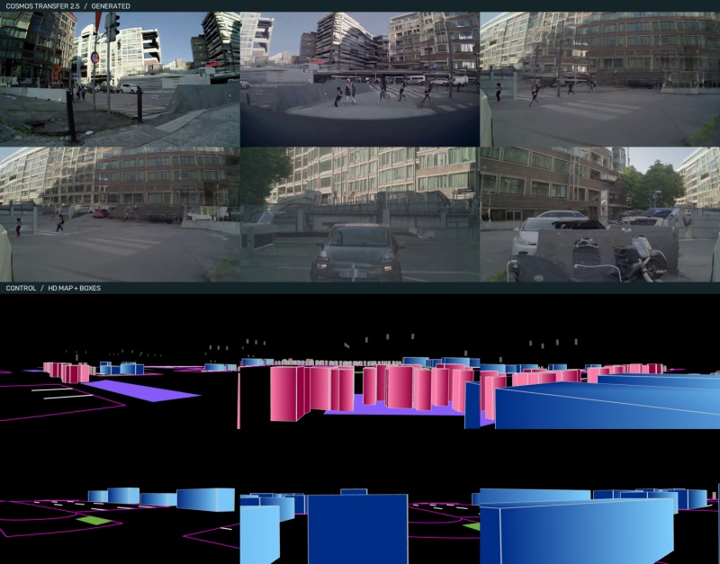
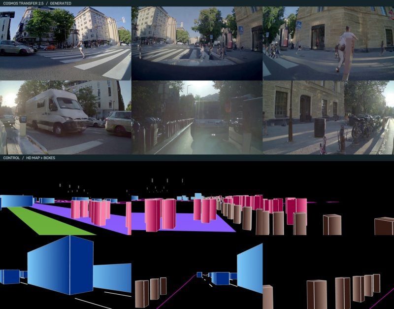
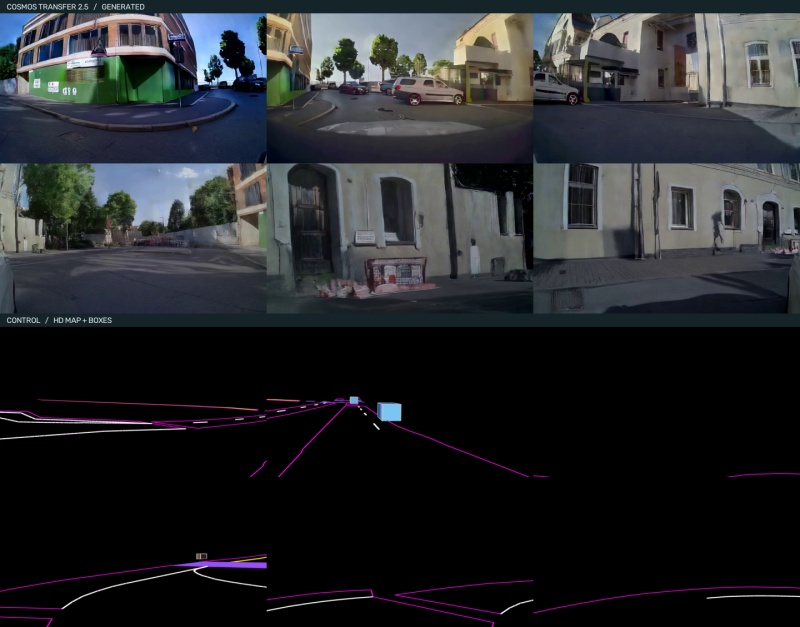
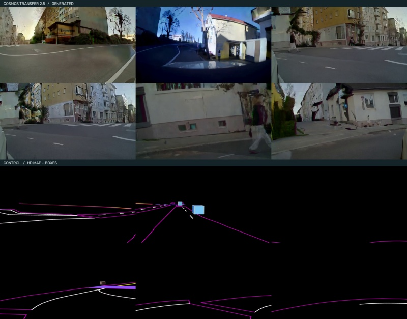
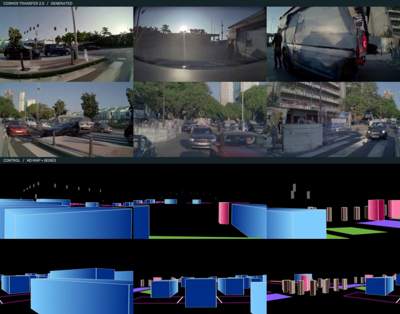
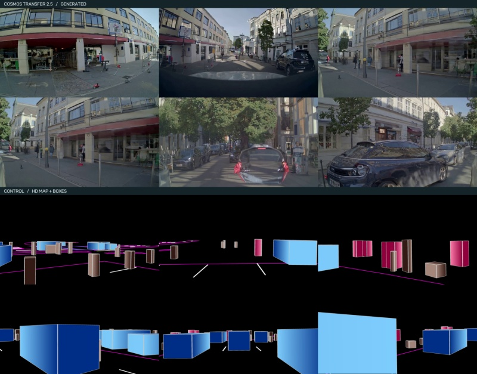
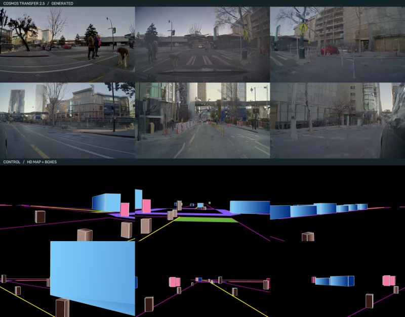
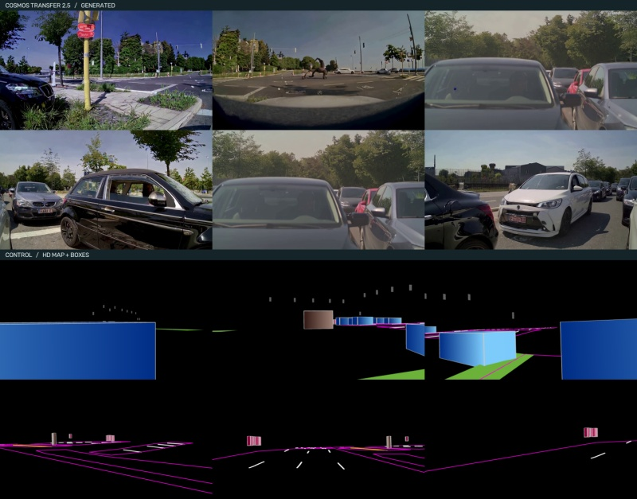
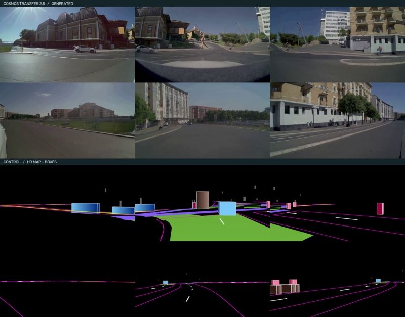
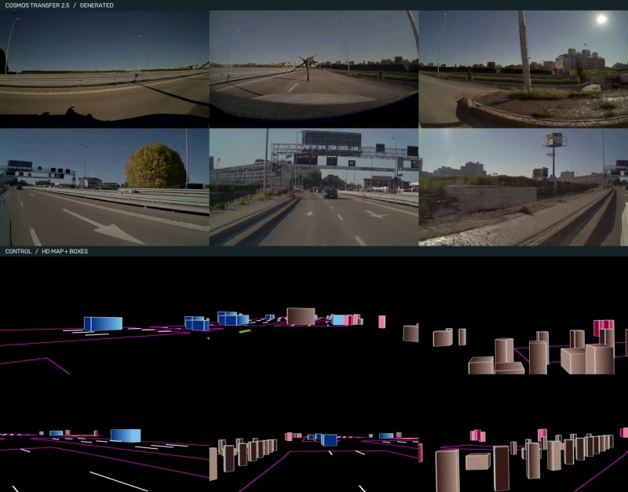

# Transfer 2.5 长尾十例 · 57 帧生成与控制对照

八卡推理，六个相机。每张预览和每条视频的上半部分是生成画面，下半部分是同一帧、同一相机的 HDMap 与目标框。首段六路无首帧，续段用首段末帧衔接。每例共 57 帧，播放速度为 10 fps。

[在线逐帧播放器](https://huster03.github.io/cosmos-cn-style-multiview-private-showcase/transfer-8ppu-57f-controls-20261121/index.html) · [十例输入文本与校验值](longtail.json)

## LT01 · 密集行人过街 · 路口

[下载完整 57 帧 MP4](https://raw.githubusercontent.com/huster03/cosmos-cn-style-multiview-private-showcase/main/transfer-8ppu-57f-controls-20261121/media/transfer-lt01.mp4) · [在播放器中打开](https://huster03.github.io/cosmos-cn-style-multiview-private-showcase/transfer-8ppu-57f-controls-20261121/index.html#transfer-lt01)

输入文本

The video shows a realistic front-facing autonomous driving scene on a marked urban road in daylight. A clearly marked zebra crosswalk spans the roadway ahead, with sidewalks, curbs, lane markings, traffic signs, roadside buildings, and normal surrounding vehicles visible in the background. A large but naturally distributed group of pedestrians enters the zebra crossing from both sides and crosses in front of the ego vehicle. The pedestrians are individually spaced rather than standing shoulder to shoulder, and they move at slightly different speeds and depths across the crosswalk, with some already crossing and others just beginning. The ego vehicle approaches the occupied crosswalk and faces a realistic dense pedestrian crossing hazard that requires slowing or stopping.

## LT02 · 密集行人过街 · 大道

[下载完整 57 帧 MP4](https://raw.githubusercontent.com/huster03/cosmos-cn-style-multiview-private-showcase/main/transfer-8ppu-57f-controls-20261121/media/transfer-lt02.mp4) · [在播放器中打开](https://huster03.github.io/cosmos-cn-style-multiview-private-showcase/transfer-8ppu-57f-controls-20261121/index.html#transfer-lt02)

输入文本

The video shows a realistic front-facing autonomous driving scene on a marked urban road in daylight. A clearly marked zebra crosswalk spans the roadway ahead, with sidewalks, curbs, lane markings, traffic signs, roadside buildings, and normal surrounding vehicles visible in the background. A large but naturally distributed group of pedestrians enters the zebra crossing from both sides and crosses in front of the ego vehicle. The pedestrians are individually spaced rather than standing shoulder to shoulder, and they move at slightly different speeds and depths across the crosswalk, with some already crossing and others just beginning. The ego vehicle approaches the occupied crosswalk and faces a realistic dense pedestrian crossing hazard that requires slowing or stopping.

## LT03 · 转弯鬼探头 · 自车停车

[下载完整 57 帧 MP4](https://raw.githubusercontent.com/huster03/cosmos-cn-style-multiview-private-showcase/main/transfer-8ppu-57f-controls-20261121/media/transfer-lt03.mp4) · [在播放器中打开](https://huster03.github.io/cosmos-cn-style-multiview-private-showcase/transfer-8ppu-57f-controls-20261121/index.html#transfer-lt03)

输入文本

The video shows a front-facing autonomous driving view on an urban roadway during daylight. The ego vehicle approaches and completes a left turn. After the turn, a stationary vehicle is parked along the right side of the road and initially hides a pedestrian behind its rear corner. Only after the ego vehicle has completed the turn, the pedestrian suddenly steps out from behind the parked vehicle into the ego vehicle's path at a normal walking speed. The pedestrian then slows and stops while the ego vehicle detects the close-range hazard, brakes progressively, and comes to a controlled stop. The road markings, buildings, roadside infrastructure, and surrounding traffic remain consistent with the original scene.

## LT04 · 转弯鬼探头 · 行人后退

[下载完整 57 帧 MP4](https://raw.githubusercontent.com/huster03/cosmos-cn-style-multiview-private-showcase/main/transfer-8ppu-57f-controls-20261121/media/transfer-lt04.mp4) · [在播放器中打开](https://huster03.github.io/cosmos-cn-style-multiview-private-showcase/transfer-8ppu-57f-controls-20261121/index.html#transfer-lt04)

输入文本

The video shows a front-facing autonomous driving view on an urban roadway during daylight. The ego vehicle approaches and completes a left turn. After the turn, a stationary vehicle is parked along the right side of the road and initially hides a pedestrian behind its rear corner. Only after the ego vehicle has completed the turn, the pedestrian suddenly steps out from behind the parked vehicle into the ego vehicle's path at a normal walking speed. When the approaching ego vehicle gets close, the pedestrian reacts by slowing and retreating toward the rear of the parked vehicle instead of continuing into the lane. The road markings, buildings, roadside infrastructure, and surrounding traffic remain consistent with the original scene.

## LT05 · 移动自车鬼探头

[下载完整 57 帧 MP4](https://raw.githubusercontent.com/huster03/cosmos-cn-style-multiview-private-showcase/main/transfer-8ppu-57f-controls-20261121/media/transfer-lt05.mp4) · [在播放器中打开](https://huster03.github.io/cosmos-cn-style-multiview-private-showcase/transfer-8ppu-57f-controls-20261121/index.html#transfer-lt05)

输入文本

The video shows a realistic front-facing autonomous driving scene on an urban roadway in daylight. The ego vehicle is moving forward while a stationary vehicle on the right side blocks the view of a pedestrian behind its rear corner. The pedestrian remains hidden until the ego vehicle is close, then steps out from behind the vehicle into the lane and continues toward the middle of the road. As the moving ego vehicle approaches, the pedestrian reacts, slows, and retreats toward the occluding vehicle while the ego vehicle continues along the roadway.

## LT06 · 静止自车鬼探头

[下载完整 57 帧 MP4](https://raw.githubusercontent.com/huster03/cosmos-cn-style-multiview-private-showcase/main/transfer-8ppu-57f-controls-20261121/media/transfer-lt06.mp4) · [在播放器中打开](https://huster03.github.io/cosmos-cn-style-multiview-private-showcase/transfer-8ppu-57f-controls-20261121/index.html#transfer-lt06)

输入文本

The video shows a realistic front-facing autonomous driving scene on an urban roadway in daylight. The ego vehicle is stationary or moving only slightly. A vehicle stopped on the right side initially hides a pedestrian behind its rear corner. The pedestrian suddenly becomes visible only after stepping out from behind the vehicle, then continues walking forward across the lane toward the middle of the roadway at a normal walking speed without retreating.

## LT07 · 犬只横穿

[下载完整 57 帧 MP4](https://raw.githubusercontent.com/huster03/cosmos-cn-style-multiview-private-showcase/main/transfer-8ppu-57f-controls-20261121/media/transfer-lt07.mp4) · [在播放器中打开](https://huster03.github.io/cosmos-cn-style-multiview-private-showcase/transfer-8ppu-57f-controls-20261121/index.html#transfer-lt07)

输入文本

The video shows a realistic front-facing autonomous driving scene on an urban roadway in daylight. The ego vehicle is moving along a marked road with lane boundaries, roadside infrastructure, and normal surrounding traffic visible in the distance. A medium-sized dog suddenly enters from the right side at a safe distance ahead and runs across the roadway from right to left. The dog follows a natural diagonal crossing path at a brisk but plausible speed, clears the ego vehicle's lane, and creates a realistic animal-crossing hazard without colliding with the ego vehicle.

## LT08 · 大象横穿

[下载完整 57 帧 MP4](https://raw.githubusercontent.com/huster03/cosmos-cn-style-multiview-private-showcase/main/transfer-8ppu-57f-controls-20261121/media/transfer-lt08.mp4) · [在播放器中打开](https://huster03.github.io/cosmos-cn-style-multiview-private-showcase/transfer-8ppu-57f-controls-20261121/index.html#transfer-lt08)

输入文本

The video shows a realistic front-facing autonomous driving scene on a quiet urban roadway in daylight. The ego vehicle is stationary or moving only slightly, with visible lane markings, road boundaries, and sparse normal traffic in the surrounding environment. A large elephant enters the road from the right side at a controlled distance and walks steadily across toward the left side. Its slow, heavy movement forms an unusual but physically plausible animal-crossing hazard while the roadway and camera viewpoint remain stable.

## LT09 · 长颈鹿横穿

[下载完整 57 帧 MP4](https://raw.githubusercontent.com/huster03/cosmos-cn-style-multiview-private-showcase/main/transfer-8ppu-57f-controls-20261121/media/transfer-lt09.mp4) · [在播放器中打开](https://huster03.github.io/cosmos-cn-style-multiview-private-showcase/transfer-8ppu-57f-controls-20261121/index.html#transfer-lt09)

输入文本

The video shows a realistic front-facing autonomous driving scene on a broad urban road in daylight. The ego vehicle proceeds forward through a lightly populated road environment with marked lanes, curbs, and normal traffic visible around the roadway. A tall giraffe appears from the right side at a distant position and walks across the road toward the left. The giraffe moves more slowly than a running animal, remains upright with a tall irregular silhouette, and crosses in world-consistent motion without being carried sideways by the ego vehicle.

## LT10 · 恐龙横穿

[下载完整 57 帧 MP4](https://raw.githubusercontent.com/huster03/cosmos-cn-style-multiview-private-showcase/main/transfer-8ppu-57f-controls-20261121/media/transfer-lt10.mp4) · [在播放器中打开](https://huster03.github.io/cosmos-cn-style-multiview-private-showcase/transfer-8ppu-57f-controls-20261121/index.html#transfer-lt10)

输入文本

The video shows a front-facing autonomous driving scene on an open urban roadway in daylight. The ego vehicle is moving forward on a marked road with lanes, roadside boundaries, and sparse traffic visible in the distance. An exceptionally large dinosaur-like animal enters from the right side far ahead and crosses toward the left side of the road. The animal moves at a faster but still coherent running pace, has a large irregular non-vehicle silhouette, and creates an extreme long-tail road hazard while remaining on a world-consistent trajectory ahead of the approaching ego vehicle.

